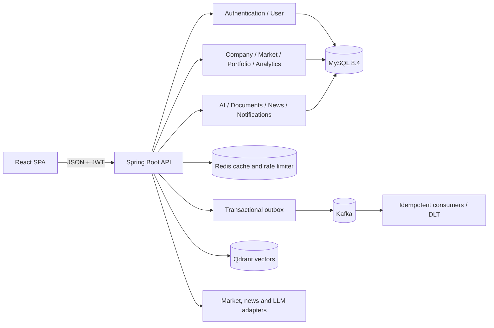
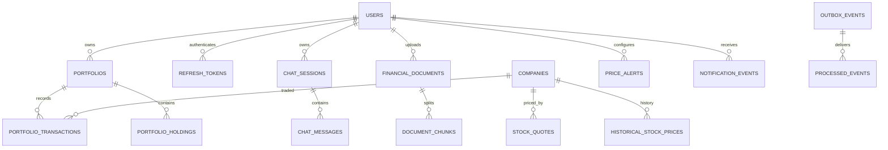
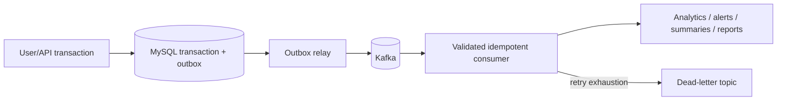
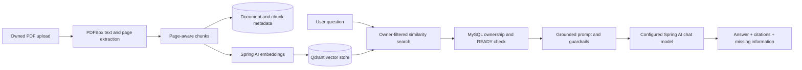

# FinSight AI

FinSight AI is a Java 17 / Spring Boot modular monolith for Indian equity portfolio tracking and document-grounded financial research. The backend is paired with a responsive React + TypeScript dashboard. Market values, news and AI outputs are provider-backed; missing data remains explicitly unavailable rather than being fabricated.

## Project layout

```text
FinSight-AI/
├── backend/     Java 17 / Spring Boot application
├── frontend/    React + TypeScript dashboard
├── outputs/     Architecture roadmap and Postman collection
├── compose.yaml Local MySQL, Redis, Kafka, and Qdrant services
└── .env         Local configuration (create from .env.example)
```

## Architecture



### Modules

`authentication` and `user` manage BCrypt credentials, JWT access tokens, rotating opaque refresh tokens, and user profiles. `company` and `marketdata` provide transaction-eligible company search, quotes, and history through replaceable provider interfaces. `stockexplorer` imports a separate NSE directory into `stock_explorer_listings`; orders select an active directory listing and resolve its symbol to a configured portfolio instrument. `portfolio` manages pending, market, and limit orders; executions create ledger transactions and update weighted-average cost basis and realized P&L. `analytics` calculates returns, XIRR, allocation, concentration, volatility, and drawdown in Java. `document` stores owned PDF metadata in MySQL and vectors in Qdrant. `aiassistant` provides session chat, grounded answers, and asynchronous research reports. `news` and `notification` cover provider news summaries and price/portfolio events. `common` contains API envelopes, error handling, correlation IDs, and cache/scheduling setup.

## Data model



Flyway owns schema evolution (`backend/src/main/resources/db/migration`). MySQL is the metadata and relational source of truth; Qdrant only stores searchable vector passages and each retrieval is constrained by user/document metadata and checked against MySQL ownership/status.

### Stock Explorer directory import

The Stock Explorer directory is stored in `stock_explorer_listings`. Download `EQUITY_L.csv` from the [NSE securities page](https://www.nseindia.com/market-data/securities-available-for-trading) and place it at `backend/data/nse/EQUITY_L.csv` (or set `NSE_EQUITY_CSV_PATH` in `.env`). On backend startup, the importer validates the expected CSV columns, upserts by `(exchange_code, symbol)`, and marks omitted listings inactive. It runs at most once per India calendar day and reads the local file only. The order form offers listings from this table when a WebSocket price is configured for that symbol; the backend maps the selected NSE listing to its portfolio instrument when placing the order.

## Async events



The API persists user-facing actions without requiring Kafka. The outbox relay publishes events after commit. Consumers record processed event IDs and use retry/backoff with dead-letter handling. Topics include `stock-price-update-topic`, `portfolio-transaction-topic`, `financial-news-topic`, `ai-report-request-topic`, and `notification-topic`; failed events route to a DLT.

For local Kafka, start Docker Desktop and run `docker compose up -d kafka-init` from the project root. Compose starts Kafka, waits for its health check, and creates the application topics (including dead-letter topics). The backend connects from the host through `localhost:29092`.

### Live financial headlines

The default provider fetches India-focused headlines from GDELT and Google News RSS. The first sync runs shortly after backend startup; later syncs use `NEWS_SYNC_FIXED_DELAY` (one hour by default). FinSight stores headline metadata and story links, not full publisher articles. Each story links to its source, and the news screen credits the GDELT Project. Automatic AI summaries stay disabled by default, so headline ingestion does not depend on Kafka or an OpenAI key.

### Price alert email

Price alert emails are routed to `ashishshewale0306@gmail.com` by default. To deliver them through Gmail, set `EMAIL_NOTIFICATIONS_ENABLED=true`, `EMAIL_ALERT_RECIPIENT=ashishshewale0306@gmail.com`, `SMTP_HOST=smtp.gmail.com`, `SMTP_PORT=587`, `SMTP_USERNAME` to the sending Gmail account, `GMAIL_APP_PASSWORD` to its Google app password, `SMTP_AUTH=true`, `SMTP_STARTTLS=true`, and `EMAIL_FROM` to that sending account in the local `.env`. Keep the app password private. Restart the backend after configuring mail. Emails are sent after an alert crosses its threshold and the database transaction commits.

## RAG flow



RAG is enabled only when a chat provider and embedding provider are configured. Retrieved passages are treated as untrusted evidence, not instructions. The assistant reports missing evidence and includes source document/page references when available. Outputs are informational and are not investment advice.

## APIs

All application routes use `/api/v1` and return `{success,message,data,timestamp,correlationId}` envelopes. OpenAPI UI is available at `/swagger-ui.html`.

| Area | Routes |
|---|---|
| Authentication | `POST /auth/register`, `/auth/login`, `/auth/refresh`, `/auth/logout`; `GET /users/me` |
| Companies and market | `GET /companies?query=&page=&size=`, `GET /companies/{id}`, `GET /companies/compare?ids=`, `GET /companies/{id}/quotes/latest`, `GET /companies/{id}/prices` |
| Live mock market | When `MARKET_DATA_PROVIDER=mock`: `GET /market/mock-stocks`, `GET /market/mock-stocks/tradable-listings`, `GET /market/mock-stocks/{symbol}/history`, WebSocket `/ws` STOMP subscriptions `/topic/stock-prices` or `/topic/stock-prices/{symbol}` |
| Stock Explorer | `GET /stock-explorer?query=&page=&size=` (reads the separate `stock_explorer_listings` directory) |
| Portfolios | `GET/POST /portfolios`, `GET/DELETE /portfolios/{id}`, `GET /portfolios/{id}/holdings`, `GET /portfolios/{id}/transactions`, `GET /portfolios/{id}/analytics`, `GET/POST /portfolios/{id}/orders`, `PUT/DELETE /portfolios/{id}/orders/{orderId}` |
| Assistant | `POST /ai/chat`, `POST/GET /ai/chat/sessions`, `GET /ai/chat/sessions/{id}/messages`, `POST /ai/reports`, `GET /ai/reports/{id}` |
| Documents | `POST/GET /documents`, `GET/DELETE /documents/{id}` |
| News and notifications | `GET /news`, `GET /news/{id}`, `POST /news/{id}/summarize`, `GET /notifications`, `PATCH /notifications/{id}/read`, `GET/POST /alerts`, `POST /alerts/{id}/reactivate`, `DELETE /alerts/{id}` |

An importable Postman collection is at [`outputs/FinSight-AI.postman_collection.json`](outputs/FinSight-AI.postman_collection.json).

The step-by-step local testing guide is at [outputs/FinSight-AI-Local-Testing-Guide.docx](outputs/FinSight-AI-Local-Testing-Guide.docx). It covers setup, NSE listings, mock quotes, market and limit orders, editing/cancelling pending orders, portfolio P&L, alerts, news, documents, APIs, logs, and troubleshooting.

Portfolio orders use the server's latest WebSocket-fed price. Market orders execute immediately at that price. Buy limit orders wait until the price is at or below the limit; sell limit orders wait until the price is at or above it. Executions create portfolio transaction records, so holdings and P&L update through the normal ledger path. Owners can modify or cancel pending orders; filled, rejected, and cancelled orders cannot be edited. The order page polls order and portfolio status while open. Mock quotes update one latest `stock_quotes` record per instrument, maintain bounded in-memory chart history, and broadcast over STOMP/WebSocket. Alerts evaluate quote threshold crossings including mock practice quotes, then disable after firing; owners can reactivate them. SMTP email notifications are disabled by default and require SMTP credentials. Redis caches quotes and Stock Explorer search results for 20 seconds by default; cache failures are handled so database-backed features continue.

### Application logs

Backend logs include the correlation ID in the level prefix. Important workflows log summaries for authentication outcomes (without credentials or tokens), quote refresh/import/news sync, order lifecycle, alert lifecycle, document processing status, outbox publishing, Kafka dead-letter events, and unexpected API errors. Routine quote ticks and successful individual Kafka events are not logged at INFO to avoid noisy logs. For local troubleshooting, inspect the IntelliJ backend console and search by `corr:<id>` or workflow identifier such as `orderId`, `alertId`, or `documentId`. Never copy `.env`, passwords, JWTs, Gmail app passwords, or private document text into logs or bug reports.

## Technology

Java 17, Spring Boot 3.5, Spring AI 1.1, Spring Security, Spring Data JPA, Spring Batch, MySQL 8.4, Flyway, Redis, Kafka, Qdrant, React 19, TypeScript, Tailwind CSS, Axios, Recharts, Maven, Docker Compose, JUnit 5, Mockito, and Springdoc OpenAPI.

## Local setup

Requirements: JDK 17, Maven 3.6.3+, Docker Compose v2, and Node.js 20+ with npm.

1. Copy `.env.example` to `.env`, set local database passwords, and replace `JWT_SECRET` with a Base64-encoded random key (at least 32 decoded bytes). PowerShell: `[Convert]::ToBase64String([Security.Cryptography.RandomNumberGenerator]::GetBytes(32))`.
2. Start local infrastructure: `docker compose up -d`.
3. Export the app variables from `.env` into the shell. Compose reads `.env`; Spring Boot does not. For PowerShell, assign `DB_URL`, `DB_USERNAME`, `DB_PASSWORD`, and `JWT_SECRET` in `$env:`.
4. From the project root, run the API with `cd backend; mvn spring-boot:run`. Flyway applies migrations; Hibernate validates rather than creating schema.
5. Run the UI in another terminal from the project root: `cd frontend; npm ci; npm run dev`. Default API base is `http://localhost:8080/api/v1`; override with `VITE_API_BASE_URL` if needed.
6. Open `http://localhost:5173`, API docs at `http://localhost:8080/swagger-ui.html`, and health at `http://localhost:8080/actuator/health`.

### Environment variables

| Variable | Purpose |
|---|---|
| `DB_URL`, `DB_USERNAME`, `DB_PASSWORD` | MySQL JDBC connection |
| `MYSQL_DATABASE`, `MYSQL_USER`, `MYSQL_PASSWORD`, `MYSQL_ROOT_PASSWORD` | Compose MySQL initialization |
| `JWT_SECRET`, `JWT_ISSUER`, `JWT_ACCESS_TTL`, `JWT_REFRESH_TTL` | JWT signing and token lifetimes |
| `SERVER_PORT`, `DB_POOL_SIZE` | API port and connection pool |
| `REDIS_HOST`, `REDIS_PORT` | Redis service |
| `KAFKA_BOOTSTRAP_SERVERS` | Kafka broker |
| `QDRANT_HOST`, `QDRANT_GRPC_PORT`, `QDRANT_COLLECTION` | Qdrant endpoint and collection |
| `OPENAI_API_KEY`, `FINSIGHT_AI_ENABLED` | Optional OpenAI-compatible assistant provider |
| `SPRING_AI_MODEL_CHAT`, `SPRING_AI_MODEL_EMBEDDING` | Select `openai` to enable chat and embeddings; defaults disable external AI |
| `OPENAI_CHAT_MODEL`, `OPENAI_EMBEDDING_MODEL` | Configurable model names |
| `MARKET_DATA_PROVIDER` | Set to `mock` for explicitly labeled, changing practice prices; defaults to `unavailable` |
| `MOCK_STOCK_UPDATE_INTERVAL`, `MOCK_STOCK_MIN_CHANGE_PERCENT`, `MOCK_STOCK_MAX_CHANGE_PERCENT`, `MOCK_STOCK_HISTORY_LIMIT` | Mock quote tick rate, per-tick fluctuation range, and in-memory chart history length |
| `EMAIL_NOTIFICATIONS_ENABLED`, `EMAIL_FROM`, `EMAIL_ALERT_RECIPIENT`, `SMTP_HOST`, `SMTP_PORT`, `SMTP_USERNAME`, `GMAIL_APP_PASSWORD`, `SMTP_AUTH`, `SMTP_STARTTLS` | Optional Gmail SMTP delivery for triggered alerts; put `GMAIL_APP_PASSWORD` in IntelliJ Run Configuration environment and keep it private |
| `FINSIGHT_MARKET_DATA_SYNC_ENABLED`, `FINANCIAL_NEWS_SYNC_ENABLED` | Optional scheduled provider ingestion |
| `FINANCIAL_NEWS_PROVIDER`, `FINANCIAL_NEWS_AUTO_SUMMARIZE` | News source selection and optional AI summaries |
| `STOCK_EXPLORER_IMPORT_ENABLED`, `NSE_EQUITY_CSV_PATH` | Daily local NSE CSV import and its file path |
| `DOCUMENT_STORAGE_DIR`, `DOCUMENT_MAX_FILE_SIZE` | Local document storage directory and upload limit |
| `CACHE_TTL` | Redis cache lifetime; defaults to `PT20S` |

Keep real credentials in an environment/secret manager and out of source control. The browser demo stores short-lived tokens in `sessionStorage`; production should move refresh tokens to an HttpOnly, Secure, SameSite cookie with an explicit CSRF policy.

## Sample requests

Register and login:

```http
POST /api/v1/auth/register
Content-Type: application/json

{"email":"person@example.com","password":"a-long-unique-passphrase","displayName":"Person"}
```

Create a portfolio with the returned access token:

```http
POST /api/v1/portfolios
Authorization: Bearer <accessToken>
Content-Type: application/json

{"name":"Long term","baseCurrency":"INR"}
```

Ask the assistant:

```http
POST /api/v1/ai/chat/sessions
Authorization: Bearer <accessToken>
Content-Type: application/json

{"title":"Annual report research","documentId":"<owned-document-id>"}
```

Use the returned session ID to ask a question:

```http
POST /api/v1/ai/chat
Authorization: Bearer <accessToken>
Content-Type: application/json

{"sessionId":"<session-id>","question":"What are the major risks mentioned in the report?"}
```

## Testing and build

```bash
cd backend && mvn verify
cd ../frontend && npm ci && npm run build
```

The project includes unit tests for JWT token issuance/validation and financial calculations. Integration tests against MySQL/Kafka remain a follow-up and require a working Docker daemon. Frontend output is generated in `frontend/dist`.

## Deployment

Build a Java 17 runtime artifact from `backend/` with `mvn clean package` and serve `frontend/dist` from a static web server or CDN. Deploy MySQL, Redis, Kafka, and Qdrant as managed services or secured private infrastructure. Provide secrets through the deployment secret manager, terminate TLS at the ingress, restrict actuator exposure, configure backups and retention, and set provider sync toggles deliberately. Compose is for local development, not production deployment.

## Calculation assumptions and limitations

Transactions use weighted-average cost basis. Unrealized P&L is current market value minus the remaining cost basis; its percentage uses the same priced holdings' investment cost. When some holdings have no quote, the value and P&L are partial and the API reports the unpriced count; total return remains unavailable until all positions are priced. Mock market ticks update each company's latest `stock_quotes` row and stream over WebSocket, so the Portfolio screen recalculates its display on each tick. XIRR uses dated cash flows and is unavailable when cash-flow roots are absent or ambiguous. CAGR requires a positive beginning/end valuation over a positive period. Volatility and maximum drawdown need sufficient dated price history and use the available stored observations; short or incomplete histories are not annualized as authoritative. Financial metrics, quotes, news, and model output depend on configured providers and their freshness/coverage.
