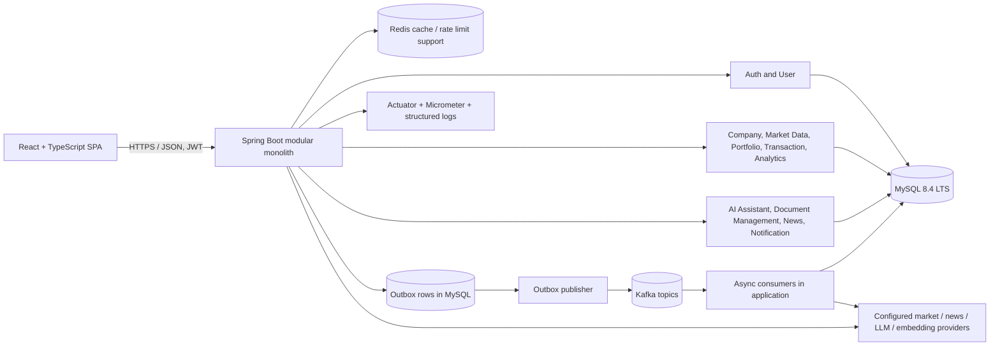
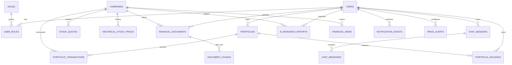
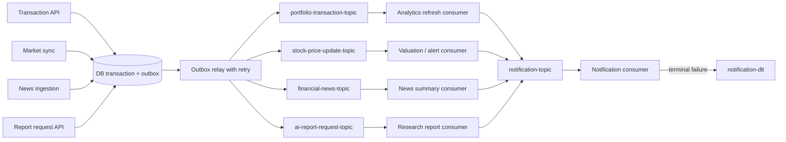
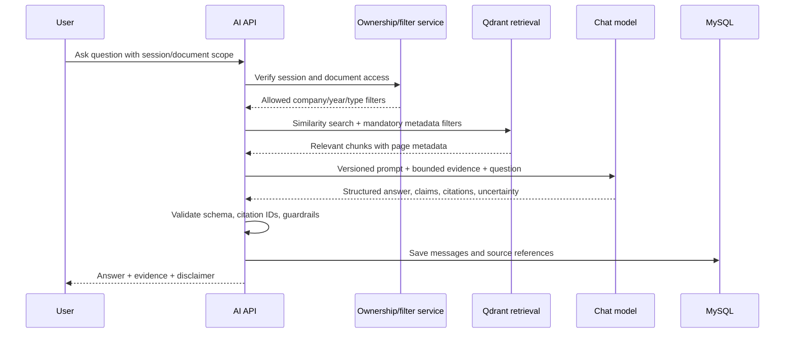

# FinSight AI — Architecture and Development Plan

**Status:** Implementation assembled across the requested modules; Java 17 + MySQL selected; compilation/integration verification pending environment support.  
**Date:** 2026-11-20

## 1. Goals and scope

FinSight AI is a security-conscious modular monolith for Indian equity research and portfolio intelligence. It combines deterministic portfolio calculations and provider-sourced market data with document-grounded AI features. The initial release targets one deployable Spring Boot application and one React application; module boundaries, events, and provider contracts keep later extraction possible.

### Product principles

- Never represent unavailable, delayed, or local mock quotes as live data. Every quote carries provider, observed-at time, currency, and freshness/status metadata.
- Keep money and portfolio metrics in deterministic Java domain services. The LLM explains sourced facts and calculations; it does not calculate, invent prices, or execute SQL.
- Enforce ownership at the service/repository boundary for portfolios, chat sessions, documents, chunks, and reports.
- Treat uploaded content and retrieved passages as untrusted input. Retrieved text is quoted as evidence, never as instructions.
- Keep synchronous flows independent of Kafka. Persist the user’s primary action first, then publish durable outbox events for asynchronous work.
- Make market, embedding, chat, and news providers replaceable through interfaces and configuration.

## 2. Proposed system architecture



### Runtime boundaries

- **Frontend:** React SPA, feature folders, typed API client, route guards for UX only. Backend remains the authorization authority.
- **Backend:** Spring Boot 3.5 on Java 17. A single application with package/module boundaries and no module-to-module repository access. Modules expose application services or domain events.
- **Persistence:** MySQL 8.4 LTS as the relational system of record. Flyway owns schema changes. Qdrant stores document embeddings and searchable chunk payloads; MySQL remains canonical for document metadata and access control. Every vector result must be re-authorized against MySQL before use.
- **Cache:** Redis for short-lived quote/search caching and distributed AI rate-limit counters. Cache data is never the canonical financial record.
- **Async:** Kafka plus a MySQL transactional outbox. The initial outbox relay may poll with locking; use Debezium only if operational needs justify it. Kafka is not required for login, chat response, transaction creation, or portfolio reads.
- **External integrations:** Adapters behind ports for market data, news, chat model, and embeddings. Missing configuration returns an explicit unavailable state; local mock adapters are opt-in and visibly labeled.

### Backend module structure

```text
com.finsight
  common/          API envelope, errors, correlation IDs, clock, money helpers
  authentication/  registration, login, refresh/revoke tokens, JWT security
  user/            profile, role, user lifecycle
  company/         issuer and exchange-independent company identity
  marketdata/      provider ports/adapters, quotes, historical prices, sync
  portfolio/       portfolio and holdings, ownership rules
  transaction/     transaction lifecycle, validation, ledger events
  analytics/       valuations, returns, risk and allocation calculations
  document/        upload, ownership, extraction, chunking, embeddings
  aiassistant/     chat sessions, prompts, retrieval, structured responses
  news/            ingestion, source records, summaries
  notification/    preferences, alert rules, delivery and event consumers
  infrastructure/  JPA, Kafka, Redis, provider configuration, outbox
```

Each business module follows `api → application → domain → persistence` (or adapters) internally. Controllers validate/translate HTTP requests; application services coordinate use cases; domain services own rules; repositories persist aggregates. DTOs are API contracts, entities are persistence details. MapStruct is used at API boundaries where it improves clarity; avoid mapping abstractions for trivial value types. Use constructor injection and immutable request/response records where suitable.

## 3. Core request and data flows

### Portfolio transaction

1. Authenticated request is validated and the caller’s portfolio ownership is checked.
2. Transaction service records the transaction in a database transaction and updates the holding/derived state according to a documented ledger rule.
3. An outbox row is committed in the same transaction.
4. API returns the accepted transaction without waiting for Kafka.
5. Outbox relay publishes `PortfolioTransactionRecorded`; a consumer idempotently requests analytics refresh and emits any required alert event.

### Quote update and portfolio value

1. Scheduled sync calls a configured `MarketDataProvider` adapter.
2. Persist only provider-returned observations, including source, timestamp, currency, and status. Do not silently substitute mock data.
3. Publish quote update via outbox. Consumers refresh impacted valuations/alerts.
4. Reads may use Redis for recent provider responses, with TTL and freshness exposed to clients.

### AI chat / document grounding

1. Authenticate, apply per-user and global rate limits, validate message size, and load only the caller’s session/document scope.
2. Classify/route to a named prompt template and retrieve permitted document chunks using metadata filters plus vector similarity.
3. Send bounded context to the configured chat model with strict grounded-answer instructions and an output schema.
4. Validate the result, citations, and missing-information behavior; save user and assistant messages with references and model metadata.
5. Return answer, evidence references, and an explicit investment-information disclaimer. Provider/model failures return a controlled error or a clearly marked unavailable response; no made-up answer.

## 4. Database design and ER diagram

All owned records include `created_at`, `updated_at`, and where useful `created_by`; use UUID identifiers stored as `CHAR(36)` in the initial MySQL schema. Monetary quantities use `DECIMAL(19,4)` or more precise instrument-specific fields; prices and quantities must not use binary floating point. Store timestamps as UTC `TIMESTAMP(6)` in UTC.. Exchange and currency are explicit, not inferred from ticker symbols.



### Tables and constraints

| Table | Main fields and integrity rules |
|---|---|
| `users`, `roles`, `user_roles` | Unique normalized email; BCrypt hash; role join unique `(user_id, role_id)`; never return hash. Refresh tokens should be stored hashed in a separate revocable token table if implemented as opaque tokens. |
| `companies` | Stable internal UUID; exchange (`NSE`/`BSE`), exchange symbol, ISIN when available, name, currency, active flag; unique `(exchange, symbol)`, index name/symbol for search. Allow the same issuer to have multiple listings. |
| `stock_quotes` | Company/listing, price, currency, observed time, provider, freshness/status; index `(company_id, observed_at desc)`. Preserve provenance; avoid overwriting a quote from a different provider without an explicit policy. |
| `historical_stock_prices` | Company, interval/date, OHLC, volume, currency, provider; unique `(company_id, interval, price_time, provider)`; range index. |
| `portfolios` | Owner, name, base currency, archived flag; index `(user_id, updated_at desc)`. |
| `portfolio_holdings` | Portfolio, company/listing, quantity and derived average cost; unique `(portfolio_id, company_id)` if holdings represent current net positions. Prefer deriving cost basis from transactions or maintain it transactionally with reconciliation. |
| `portfolio_transactions` | Portfolio, company, side, quantity, unit price, fees, trade time, currency, external reference/idempotency key; positive quantity/price constraints and owner-scoped indexes. Append/correct via reversal or adjustment; do not silently rewrite history. |
| `chat_sessions`, `chat_messages` | Owner and optional company/document context; session index `(user_id, updated_at desc)`; message sequence unique within session; store prompt version/model and structured citation JSON. |
| `financial_documents` | Owner, company, financial year, type, original name, object key, MIME, checksum, processing state, page count. Unique checksum may be owner-scoped. Store file bytes outside MySQL in local volume for development and private object storage in deployment; DB stores metadata only. |
| `document_chunks` | Document, page range, ordinal, text, metadata, content checksum, chunking/embedding version, and Qdrant point ID; unique `(document_id, ordinal)`. Chunk text and embeddings are stored in Qdrant with owner/document/company/year/type/page payload metadata. Re-check access through MySQL before returning any retrieved passage. |
| `ai_research_reports` | Owner, company, request status, prompt/model versions, output JSON/text, sources, failure detail; idempotency key. |
| `financial_news` | Source/provider ID unique per source; published time, URL, company links, raw text reference and summary status. |
| `notification_events`, `price_alerts` | User, event type, payload, status/read/delivered timestamps; alert threshold/operator and enabled flag; dedupe key unique per user/event. |
| `processed_events`, `outbox_events` | Consumer/event key unique for idempotency; outbox event type, aggregate key, JSON payload, correlation ID, created/published timestamps, retry count. Index unpublished rows. |

Flyway migrations create MySQL tables, constraints, and indexes. Qdrant collection initialization is managed by the document/RAG adapter in its own deployment configuration, not by a MySQL migration. Local Compose pins compatible MySQL 8.4 LTS, Redis, Kafka, and Qdrant images. Startup must fail clearly if a required service is unavailable rather than leaving a feature partially enabled.

## 5. REST API outline

Prefix: `/api/v1`. JSON API envelope for normal responses: `{success, message, data, timestamp, correlationId}`. Validation errors include a stable error code and field details. Page responses include `content`, `page`, `size`, `totalElements`, and `totalPages`. Use ISO-8601 timestamps and decimal strings/JSON numbers with documented precision. OpenAPI documents auth, errors, pagination, rate limits, and provider freshness.

| Method and path | Purpose / authorization |
|---|---|
| `POST /auth/register` | Create user; returns safe profile and tokens or a documented verification state. |
| `POST /auth/login` | Authenticate and issue short-lived access + refresh credentials. |
| `POST /auth/refresh`, `POST /auth/logout` | Rotate/revoke refresh credential; refresh rotation is single-use. |
| `GET /users/me`, `PATCH /users/me` | Current profile. |
| `GET /companies?query=&exchange=&page=&size=` | Search listed companies. |
| `GET /companies/{companyId}` | Company/listing details. |
| `GET /companies/{companyId}/quotes/latest` | Latest available quote plus source/freshness; unavailable status is explicit. |
| `GET /companies/{companyId}/prices?from=&to=&interval=` | Historical prices, paginated/bounded. |
| `GET /companies/compare?ids=` | Deterministic comparison metrics with source/as-of metadata. |
| `GET/POST /portfolios` | List/create caller-owned portfolios. |
| `GET/PATCH/DELETE /portfolios/{id}` | Read/update/archive owned portfolio. Delete should default to archive where ledger history exists. |
| `GET /portfolios/{id}/holdings` | Current positions and quote freshness. |
| `POST /portfolios/{id}/transactions` | Add validated transaction; supports idempotency key. |
| `GET /portfolios/{id}/transactions` | Filtered/paginated transaction ledger. |
| `GET /portfolios/{id}/analytics?asOf=` | Deterministic returns, P&L, risk metrics and calculation coverage. |
| `POST /documents` | Multipart PDF upload; ownership and file limits enforced; returns processing status. |
| `GET /documents` / `GET /documents/{id}` | Caller’s document list/status and metadata. |
| `DELETE /documents/{id}` | Soft-delete and schedule removal of chunks/blob subject to retention policy. |
| `POST /ai/chat/sessions` | Create chat session, optional company/document scope. |
| `GET /ai/chat/sessions` | List caller-owned sessions. |
| `GET /ai/chat/sessions/{sessionId}/messages` | Paginated messages with citations. |
| `POST /ai/chat` | Send message in a session; bounded synchronous response (async report is a separate endpoint). |
| `POST /ai/reports` / `GET /ai/reports/{id}` | Request/read asynchronous company research report. |
| `GET /news` | Filtered news; summaries identify source and generated status. |
| `GET/POST /alerts` | List/create caller-owned price alerts. |
| `GET /notifications` / `PATCH /notifications/{id}` | List and mark caller-owned notifications read. |
| `GET /actuator/health` | Liveness/readiness exposure is restricted and sanitized by environment. |

Use `401` for unauthenticated, `403` for authenticated but unauthorized, `404` for missing/foreign-owned resources where non-disclosure is desirable, `409` for idempotency/conflict, `422` for semantic validation, `429` for rate limits, and `503` for unavailable external provider capabilities. Avoid leaking whether another user’s object exists.

## 6. Kafka event flow



### Delivery and reliability rules

- Define versioned event envelopes: `eventId`, `eventType`, `schemaVersion`, `occurredAt`, `correlationId`, `aggregateId`, `producer`, `payload`.
- Use outbox for database state changes that must cause an event. Relay publishes at least once; consumers deduplicate `(consumer_name, event_id)` using `processed_events` in the same transaction as their effect.
- Configure bounded exponential retry with jitter for transient failures. Permanent schema/validation failures go directly to a DLT; exhausted retries go to the relevant topic DLT. Include original topic, partition, offset, exception class, and correlation ID in DLT metadata without sensitive document text.
- Partition by portfolio/company/user aggregate key where ordering is required. Do not assume global ordering.
- Validate event schema before business processing. Monitor lag, retry count, DLT count, and oldest unpublished outbox row.
- Keep topic names as required (`stock-price-update-topic`, `portfolio-transaction-topic`, `financial-news-topic`, `ai-report-request-topic`, `notification-topic`, `notification-dlt`); add per-domain DLTs later if operational isolation requires it.

## 7. RAG and AI design



### Ingestion

1. Validate PDF MIME/signature, size, page count, malware scan integration point, and ownership. Store blob privately; calculate checksum.
2. Extract text and page boundaries using a PDF library selected and license-checked in Phase 7. Persist extraction state and page count in MySQL; reject encrypted/corrupt files with a user-visible state.
3. Chunk on page/section boundaries with overlap and bounded token size. Keep document ID, owner, company, fiscal year, document type, page start/end, chunk ordinal, extractor version.
4. Generate embeddings through an `EmbeddingModel` adapter. Store vectors and filterable payloads in Qdrant and canonical chunk metadata/point IDs in MySQL; mark processing complete only after all chunks succeed. Retry safely by document/version and clean stale partial chunks.
5. Retrieval always scopes by owner ACL first, then optional company/year/type/document filters, then vector similarity. Never rely on vector similarity as authorization.

### Prompt and response design

Maintain versioned templates for company analysis, financial statement explanation, news summary, stock comparison, risk identification, and annual report summary. A structured response should contain `answer`, `sourcedFacts[]` (claim and citation IDs), `interpretations[]`, `missingInformation[]`, and `disclaimer`. Citation IDs must map to retrieved chunks with page numbers; reject or strip unsupported citations. Distinguish direct document fact from model interpretation in the UI. If evidence is absent or retrieval is weak, state that the available sources do not establish the answer.

Guard against prompt injection by delimiting evidence as quoted untrusted material, stating that instructions inside documents are not instructions, restricting tools to typed read-only application services, and never allowing model-generated SQL. Validate tool inputs and user ownership again at execution. Do not send one user’s chunks in another user’s context. Track model, prompt version, latency, usage where exposed, and provider errors; avoid logging raw private document text.

## 8. Analytics definitions and limitations

Analytics are implemented in Java with `BigDecimal` for money and `double`/stable numeric algorithms only where statistical formulas demand it. Define a calculation policy and test examples before exposing metrics.

| Metric | Proposed definition and required caveats |
|---|---|
| Total investment | Net external acquisition cash flow, including configured fees/taxes; distinguish gross purchase value from net cost basis. |
| Current value | Current net quantity × latest acceptable quote. Include quote timestamp/status; if unavailable/stale, mark valuation incomplete rather than fabricating. |
| Realized P&L | Proceeds less allocated cost basis and fees on sold quantity. Choose and document FIFO as initial cost basis policy; corporate actions need explicit support. |
| Unrealized P&L | Current value less remaining cost basis. Exclude/flag positions with missing quotes. |
| Absolute / percentage return | State whether cash flows are time-weighted or money-weighted. Dashboard headline should use XIRR when cash flow dates are valid; simple return is supplementary and clearly named. |
| XIRR | Newton iteration with bounded fallback (bisection), dated contributions negative and terminal value positive; report no result for invalid/insufficient cash flows and disclose annualization. |
| CAGR | `(ending value / beginning value)^(365.25 / elapsed days) - 1`; requires positive endpoints and ignores interim cash-flow effects, so use only for a single invested amount or labeled series. |
| Asset allocation / concentration | Market value weights by company/sector/currency; concentration can report top-N share and Herfindahl-Hirschman Index. Unpriced assets lower coverage. |
| Volatility | Annualized standard deviation of periodic total returns; disclose frequency, lookback, sample size, and that price history may omit dividends. |
| Maximum drawdown | Largest peak-to-trough decline in the selected dated valuation series; disclose period and data coverage. |

## 9. Security, privacy, and operations

- Spring Security stateless resource server with short-lived signed access JWTs and rotating, revocable refresh tokens. Keep signing keys outside source control; define key rotation and issuer/audience validation. BCrypt password hashing with strength configured for deployment hardware.
- Role checks supplement, never replace, ownership checks. Every object access query is owner-scoped; document chunk retrieval follows document ACL. Use generic not-found behavior for foreign objects.
- Validate DTOs, upload content, query lengths, sort fields, and pagination bounds. Parameterize all database access. No LLM-generated SQL.
- Apply AI request quotas by user and IP, request/time/token bounds, concurrency limits, and provider timeouts. Redis can back distributed counters; define safe local fallback behavior.
- CORS and security headers are environment-configured. Secrets are environment/secret-manager supplied. No API keys in frontend bundles.
- Add correlation ID filter (accept only a validated bounded inbound ID or generate one), structured JSON logs, Micrometer metrics, Actuator health/info/prometheus with production access restrictions, and tracing hooks.
- Define retention/deletion behavior for documents, extracted text, embeddings, chat history, and logs. Encrypt transport and storage in deployment. Avoid logging passwords, JWTs, provider keys, or source text.
- API docs are available in local/dev profiles; production exposure is explicitly controlled.

## 10. Frontend plan

Feature-oriented React + TypeScript application: `auth`, `dashboard`, `companies`, `portfolios`, `analytics`, `assistant`, `documents`, `news`, `notifications`, and `shared`. Use a typed Axios client with centralized auth/error handling; do not place long-lived secrets in local storage. Prefer secure same-site refresh cookie where deployment permits; otherwise document the threat tradeoff for token storage. Route protection is convenience only; backend validates every request.

Dashboard includes quote freshness/source badges, explicit unavailable/mock labels, empty/error/loading states, accessible tables, responsive Recharts views, and clear chart ranges. AI views display evidence citations/page links and separate sourced facts from interpretation. Upload processing state is visible and retryable when safe.

## 11. Local development and delivery

Docker Compose supplies MySQL 8.4, Redis, Kafka (KRaft), and Qdrant. The app runs locally via Maven and frontend via npm. `.env.example` documents names and safe placeholders only. OpenAPI/Swagger UI, Postman collection, health endpoints, and Mermaid architecture/ER/event/RAG diagrams are documented in the README.

The current Maven build pins Spring Boot 3.5.16, Spring AI 1.1.8, Java 17, and maintained libraries. OpenAI chat and embeddings are disabled by default and can be enabled through configuration. MySQL remains the source of truth; Qdrant handles vector search.

## 12. Development roadmap and phase exit criteria

The phase table records the intended sequence; implementation has proceeded across backend modules and the React dashboard. Build/test verification remains pending dependency resolution and local infrastructure availability.

| Phase | Scope | Exit criteria |
|---|---|---|
| 1 — Foundation | Single Maven artifact with package modules, Java 17/Spring Boot, Compose MySQL/Redis/Kafka/Qdrant, Flyway baseline, common API/error/correlation conventions, OpenAPI. | Compile and fresh database migration verification pending. |
| 2 — Auth and users | Registration/login, BCrypt, JWT access and rotating refresh, roles, current-user profile, security tests. | Auth flows and invalid/expired/revoked token cases covered; no secrets committed. |
| 3 — Company and market data | Company model/search, provider interface, configurable adapter, explicit unavailable/local mock adapters, quote/history endpoints, cache and sync boundary. | Provider provenance/freshness is visible; mock is never mislabeled; adapter tests pass. |
| 4 — Portfolio and transactions | Owned portfolios, append-only ledger, transactions, holdings/cost-basis policy, paging/idempotency. | Cross-user isolation and transaction invariants tested. |
| 5 — Financial analytics | Deterministic metrics, price-history series, calculation policies and limitations. | Unit tests cover normal, missing-data, boundary, and invalid cash-flow cases. |
| 6 — ChatClient | Spring AI compatible dependencies, configured model adapter, chat/session/message APIs, prompt versions, structured response validation and AI limits. | Mocked LLM tests verify schema, missing evidence, failure paths, and no unsupported citations. |
| 7 — PDF and RAG | Private file storage, extraction, chunking, embedding, Qdrant retrieval, ACL filters, citations/page numbers. | Integration tests demonstrate owner isolation, metadata filtering, ingestion retries, and grounded references. |
| 8 — Kafka | Outbox, event envelopes, relay, consumers, dedupe, retries, DLT and observability. | Testcontainers or equivalent integration tests verify replay/idempotency and failure routing. |
| 9 — News and notifications | News provider/ingestion, asynchronous summaries, user preferences, price alerts, notification delivery abstraction. | Duplicate ingestion/events are safe; source provenance and delivery status are visible. |
| 10 — React dashboard | Auth UX, portfolio, explorer, analytics, assistant, upload, news, notifications. | Implemented initial responsive flows; visual and API integration review pending. |
| 11 — Hardening and docs | Unit tests, deployment guidance, complete README/Postman/OpenAPI, review. | Documentation prepared; compile, integration tests, and remaining security/performance review pending. |

## 13. Decisions to confirm before implementation

These decisions were applied in the implementation:
1. **Repository layout:** one Maven Spring Boot application with strict package/module boundaries, plus `frontend/`; extrn modules only when build or ownership boundaries justify them.
2. **File storage:** local private volume for development, object-storage adapter for deployment; MySQL stores document metadata; Qdrant stores embeddings and chunk payloads.
3. **Ledger policy:** transaction history with weighted-average cost basis and realized P&L.
4. **Quote policy:** provider observation and freshness surfaced to the UI; stale or missing quote makes valuation partial.
5. **AI provider policy:** OpenAI-compatible endpoint configured by URL/model/key, with no key default and no vendor dependency in domain modules.
6. **Market data availability:** provider adapter is configurable; local mock is disabled unless explicitly selected and all outputs visibly labeled.


