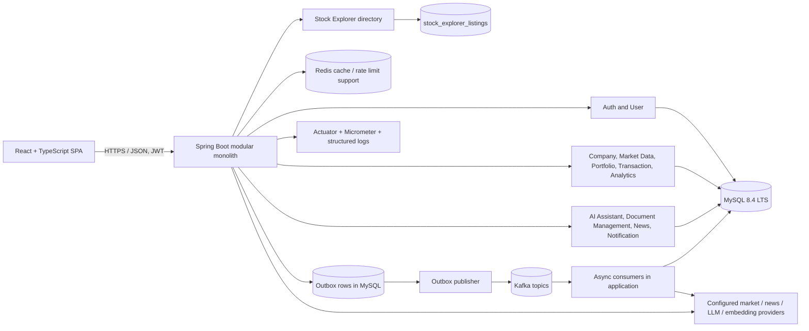
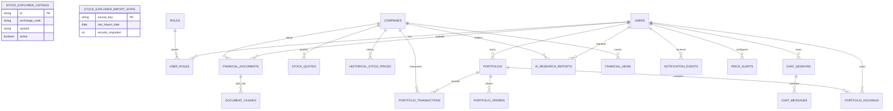
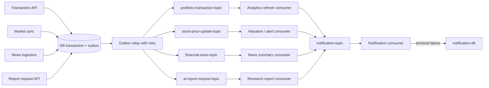
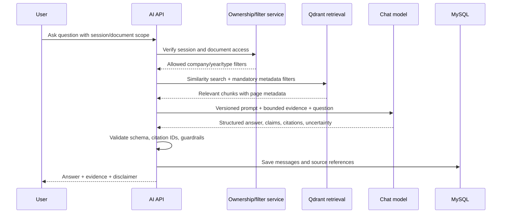

# FinSight AI — Architecture and Implementation Notes

**Status:** Describes the current Java 17, MySQL, Spring Boot, and React implementation, along with known verification limits and future hardening work.
**Updated:** 2026-11-21

This note describes the implemented Java 17 / Spring Boot and React application. The local guide and Postman collection document current flows. Build verification is recorded at the end of this file; no claim is made that optional external-provider integrations are configured.

## 1. Goals and scope

FinSight AI is a security-conscious modular monolith for Indian equity research and portfolio intelligence. It combines deterministic portfolio calculations and provider-sourced market data with document-grounded AI features. The initial release targets one deployable Spring Boot application and one React application; module boundaries, events, and provider contracts keep later extraction possible.

### Product principles

- Never represent unavailable, delayed, or local mock quotes as live data. Every quote carries provider, observed-at time, currency, and freshness/status metadata.
- Keep money and portfolio metrics in deterministic Java domain services. The LLM explains sourced facts and calculations; it does not calculate, invent prices, or execute SQL.
- Enforce ownership at the service/repository boundary for portfolios, chat sessions, documents, chunks, and reports.
- Treat uploaded content and retrieved passages as untrusted input. Retrieved text is quoted as evidence, never as instructions.
- Keep synchronous flows independent of Kafka. Persist the user’s primary action first, then publish durable outbox events for asynchronous work.
- Make market, embedding, chat, and news providers replaceable through interfaces and configuration.

## 2. Implemented system architecture



### Runtime boundaries

- **Frontend:** React SPA, feature folders, typed API client, route guards for UX only. Backend remains the authorization authority.
- **Backend:** Spring Boot 3.5 on Java 17. A single application with package/module boundaries and no module-to-module repository access. Modules expose application services or domain events.
- **Persistence:** MySQL 8.4 LTS as the relational system of record. Flyway owns schema changes. Qdrant stores document embeddings and searchable chunk payloads; MySQL remains canonical for document metadata and access control. Every vector result must be re-authorized against MySQL before use.
- **Cache:** Redis backs the `latestQuotes` and `stockExplorerListings` caches. The default Redis TTL is 20 seconds; a successful market refresh evicts its quote, and a successful NSE CSV import evicts all explorer pages. Cache data is never the canonical financial record.
- **Async:** Kafka plus a MySQL transactional outbox. The initial outbox relay may poll with locking; use Debezium only if operational needs justify it. Kafka is not required for login, chat response, transaction creation, or portfolio reads.
- **External integrations:** Adapters behind ports for market data, news, chat model, and embeddings. Missing configuration returns an explicit unavailable state; local mock adapters are opt-in and visibly labeled.

### Backend module structure

```text
com.finsight
  common/          API envelope, errors, correlation IDs, clock, money helpers
  authentication/  registration, login, refresh/revoke tokens, JWT security
  user/            profile, role, user lifecycle
  company/         transaction-eligible issuer records and company search
  stockexplorer/   imported NSE directory in a separate stock_explorer_listings table
  marketdata/      provider ports/adapters, quotes, historical prices, sync
  portfolio/       portfolio and holdings, ownership rules
  transaction/     transaction lifecycle, validation, ledger events
  analytics/       valuations, returns, risk and allocation calculations
  document/        upload, ownership, extraction, chunking, embeddings
  aiassistant/     chat sessions, prompts, retrieval, structured responses
  news/            ingestion, source records, summaries
  notification/    preferences, alert rules, delivery and event consumers
  infrastructure/  JPA, Kafka, Redis, provider configuration, outbox
```

Each business module follows `api → application → domain → persistence` (or adapters) internally. Controllers validate/translate HTTP requests; application services coordinate use cases; domain services own rules; repositories persist aggregates. DTOs are API contracts, entities are persistence details. MapStruct is used at API boundaries where it improves clarity; avoid mapping abstractions for trivial value types. Use constructor injection and immutable request/response records where suitable.

## 3. Core request and data flows

### Place and execute a portfolio order

1. The authenticated request validates ownership of the caller’s portfolio and resolves an active `stock_explorer_listings` row to a configured `companies` instrument.
2. The service checks the latest WebSocket-fed price. A market order fills immediately; a buy limit waits for price at or below its limit, and a sell limit waits for price at or above its limit.
3. On fill, the existing transaction ledger path updates holdings, weighted-average cost basis, and realized P&L in the same database transaction. Sell orders that exceed the holding are rejected.
4. Owners can edit or cancel pending orders. Filled, rejected, or cancelled orders are terminal. The API/UI reports pending, filled, or rejected status.

### Quote update and portfolio value

Configured providers can refresh persisted quote observations. In mock mode, the scheduler changes configured prices each tick, persists the latest quote row per symbol, updates bounded in-memory chart history, sends STOMP messages to `/topic/stock-prices` and `/topic/stock-prices/{symbol}`, processes alerts and pending orders, and evicts the quote cache. Mock values are labeled practice data. Portfolio value and unrealized P&L use available latest quotes; they expose incomplete coverage when some holdings are unpriced.
4. Reads may use Redis for recent provider responses, with TTL and freshness exposed to clients.

### AI chat / document grounding

1. Authenticate, apply per-user and global rate limits, validate message size, and load only the caller’s session/document scope.
2. Classify/route to a named prompt template and retrieve permitted document chunks using metadata filters plus vector similarity.
3. Send bounded context to the configured chat model with strict grounded-answer instructions and an output schema.
4. Validate the result, citations, and missing-information behavior; save user and assistant messages with references and model metadata.
5. Return answer, evidence references, and an explicit investment-information disclaimer. Provider/model failures return a controlled error or a clearly marked unavailable response; no made-up answer.

## 4. Database design and ER diagram

The Flyway migrations under `backend/src/main/resources/db/migration` define the current schema. Identifiers are stored as strings, monetary values use decimal columns, and timestamps are handled in UTC. Exchange and currency are explicit rather than inferred from ticker symbols. The ER diagram and table descriptions below are a module-level overview; the migration SQL is authoritative.



### Tables and constraints

| Table | Main fields and integrity rules |
|---|---|
| `users`, `roles`, `user_roles`, `refresh_tokens` | Unique normalized email; BCrypt hash; role join; refresh tokens are stored hashed and can be revoked. Never return password hashes or token hashes. |
| `companies` | Transaction-eligible company records with stable IDs, exchange, symbol, name, currency, and active flag. This table powers company search and portfolio transactions. |
| `stock_explorer_listings`, `stock_explorer_import_state` | Separate NSE security directory and daily import bookkeeping. CSV rows upsert by exchange and symbol; absent listings are marked inactive. Explorer entries are not portfolio instruments; the order service resolves active listings to configured instruments. |
| `stock_quotes` | Company/listing, price, currency, observed time, provider, freshness/status; index `(company_id, observed_at desc)`. Preserve provenance; avoid overwriting a quote from a different provider without an explicit policy. |
| `historical_stock_prices` | Company, interval/date, OHLC, volume, currency, provider; unique `(company_id, interval, price_time, provider)`; range index. |
| `portfolios` | Owner, name, base currency, archived flag; index `(user_id, updated_at desc)`. |
| `portfolio_orders` | Owned market/limit orders with pending, filled, cancelled, or rejected lifecycle and execution details. |
| `portfolio_holdings` | Current portfolio/company position, quantity, weighted-average cost, and cost basis, updated transactionally with each trade. |
| `portfolio_transactions` | Portfolio, company, side, quantity, unit price, fees, trade time, currency, idempotency key, and realized P&L. Sells are rejected when the portfolio lacks sufficient quantity. |
| `chat_sessions`, `chat_messages` | Owner and optional company/document context; session index `(user_id, updated_at desc)`; message sequence unique within session; store prompt version/model and structured citation JSON. |
| `financial_documents` | Owner, company, financial year, type, original name, object key, MIME, checksum, processing state, page count. Unique checksum may be owner-scoped. Store file bytes outside MySQL in local volume for development and private object storage in deployment; DB stores metadata only. |
| `document_chunks` | Document, page range, ordinal, text, metadata, content checksum, chunking/embedding version, and Qdrant point ID; unique `(document_id, ordinal)`. Chunk text and embeddings are stored in Qdrant with owner/document/company/year/type/page payload metadata. Re-check access through MySQL before returning any retrieved passage. |
| `ai_research_reports` | Owner, company, request status, prompt/model versions, output JSON/text, sources, failure detail; idempotency key. |
| `financial_news` | Source/provider ID unique per source; published time, URL, company links, raw text reference and summary status. |
| `notification_events`, `price_alerts` | User, event type, payload, status/read/delivered timestamps; alert threshold/operator and enabled flag; dedupe key unique per user/event. |
| `processed_events`, `outbox_events` | Consumer/event key unique for idempotency; outbox event type, aggregate key, JSON payload, correlation ID, created/published timestamps, retry count. Index unpublished rows. |

Flyway migrations create MySQL tables, constraints, and indexes. Qdrant collection initialization is managed by the document/RAG adapter in its own deployment configuration, not by a MySQL migration. Local Compose pins compatible MySQL 8.4 LTS, Redis, Kafka, and Qdrant images. Startup must fail clearly if a required service is unavailable rather than leaving a feature partially enabled.

## 5. REST API outline

Prefix: `/api/v1`. JSON API envelope for normal responses: `{success, message, data, timestamp, correlationId}`. Validation errors include a stable error code and field details. Page responses include `content`, `page`, `size`, `totalElements`, and `totalPages`. Use ISO-8601 timestamps and decimal strings/JSON numbers with documented precision. OpenAPI documents auth, errors, pagination, rate limits, and provider freshness.

| Method and path | Purpose / authorization |
|---|---|
| `POST /auth/register` | Create user; returns safe profile and tokens or a documented verification state. |
| `POST /auth/login` | Authenticate and issue short-lived access + refresh credentials. |
| `POST /auth/refresh`, `POST /auth/logout` | Rotate/revoke refresh credential; refresh rotation is single-use. |
| `GET /users/me`, `PATCH /users/me` | Current profile. |
| `GET /companies?query=&exchange=&page=&size=` | Search listed companies. |
| `GET /companies/{companyId}` | Company/listing details. |
| `GET /companies/{companyId}/quotes/latest` | Latest available quote plus source/freshness; unavailable status is explicit. |
| `GET /companies/{companyId}/prices?from=&to=&interval=` | Historical prices, paginated/bounded. |
| `GET /companies/compare?ids=` | Deterministic comparison metrics with source/as-of metadata. |
| `GET/POST /portfolios` | List/create caller-owned portfolios. |
| `GET/PATCH/DELETE /portfolios/{id}` | Read/update/archive owned portfolio. Delete should default to archive where ledger history exists. |
| `GET /portfolios/{id}/holdings` | Current positions and quote freshness. |
| `GET/POST /portfolios/{id}/orders` | List orders or place a market/limit order using an active NSE listing ID. |
| `PUT/DELETE /portfolios/{id}/orders/{orderId}` | Edit or cancel an owned pending order. |
| `GET /portfolios/{id}/transactions` | Read the ledger entries created when orders fill. |
| `GET /market/mock-stocks/tradable-listings` | When mock provider is active, list NSE rows with configured live prices. |
| `GET /portfolios/{id}/analytics?asOf=` | Deterministic returns, P&L, risk metrics and calculation coverage. |
| `POST /documents` | Multipart PDF upload; ownership and file limits enforced; returns processing status. |
| `GET /documents` / `GET /documents/{id}` | Caller’s document list/status and metadata. |
| `DELETE /documents/{id}` | Soft-delete and schedule removal of chunks/blob subject to retention policy. |
| `POST /ai/chat/sessions` | Create chat session, optional company/document scope. |
| `GET /ai/chat/sessions` | List caller-owned sessions. |
| `GET /ai/chat/sessions/{sessionId}/messages` | Paginated messages with citations. |
| `POST /ai/chat` | Send message in a session; bounded synchronous response (async report is a separate endpoint). |
| `POST /ai/reports` / `GET /ai/reports/{id}` | Request/read asynchronous company research report. |
| `GET /news` | Filtered news; summaries identify source and generated status. |
| `GET/POST /alerts` | List/create caller-owned price alerts. |
| `GET /notifications` / `PATCH /notifications/{id}` | List and mark caller-owned notifications read. |
| `GET /actuator/health` | Liveness/readiness exposure is restricted and sanitized by environment. |

Use `401` for unauthenticated, `403` for authenticated but unauthorized, `404` for missing/foreign-owned resources where non-disclosure is desirable, `409` for idempotency/conflict, `422` for semantic validation, `429` for rate limits, and `503` for unavailable external provider capabilities. Avoid leaking whether another user’s object exists.

## 6. Kafka event flow



### Delivery and reliability rules

- Define versioned event envelopes: `eventId`, `eventType`, `schemaVersion`, `occurredAt`, `correlationId`, `aggregateId`, `producer`, `payload`.
- Use outbox for database state changes that must cause an event. Relay publishes at least once; consumers deduplicate `(consumer_name, event_id)` using `processed_events` in the same transaction as their effect.
- Configure bounded exponential retry with jitter for transient failures. Permanent schema/validation failures go directly to a DLT; exhausted retries go to the relevant topic DLT. Include original topic, partition, offset, exception class, and correlation ID in DLT metadata without sensitive document text.
- Partition by portfolio/company/user aggregate key where ordering is required. Do not assume global ordering.
- Validate event schema before business processing. Monitor lag, retry count, DLT count, and oldest unpublished outbox row.
- Keep topic names as required (`stock-price-update-topic`, `portfolio-transaction-topic`, `financial-news-topic`, `ai-report-request-topic`, `notification-topic`, `notification-dlt`); add per-domain DLTs later if operational isolation requires it.

## 7. RAG and AI design



### Ingestion

1. Validate PDF MIME/signature, size, page count, malware scan integration point, and ownership. Store blob privately; calculate checksum.
2. Extract text and page boundaries using a PDF library selected and license-checked in Phase 7. Persist extraction state and page count in MySQL; reject encrypted/corrupt files with a user-visible state.
3. Chunk on page/section boundaries with overlap and bounded token size. Keep document ID, owner, company, fiscal year, document type, page start/end, chunk ordinal, extractor version.
4. Generate embeddings through an `EmbeddingModel` adapter. Store vectors and filterable payloads in Qdrant and canonical chunk metadata/point IDs in MySQL; mark processing complete only after all chunks succeed. Retry safely by document/version and clean stale partial chunks.
5. Retrieval always scopes by owner ACL first, then optional company/year/type/document filters, then vector similarity. Never rely on vector similarity as authorization.

### Prompt and response design

Maintain versioned templates for company analysis, financial statement explanation, news summary, stock comparison, risk identification, and annual report summary. A structured response should contain `answer`, `sourcedFacts[]` (claim and citation IDs), `interpretations[]`, `missingInformation[]`, and `disclaimer`. Citation IDs must map to retrieved chunks with page numbers; reject or strip unsupported citations. Distinguish direct document fact from model interpretation in the UI. If evidence is absent or retrieval is weak, state that the available sources do not establish the answer.

Guard against prompt injection by delimiting evidence as quoted untrusted material, stating that instructions inside documents are not instructions, restricting tools to typed read-only application services, and never allowing model-generated SQL. Validate tool inputs and user ownership again at execution. Do not send one user’s chunks in another user’s context. Track model, prompt version, latency, usage where exposed, and provider errors; avoid logging raw private document text.

## 8. Analytics definitions and limitations

Analytics are implemented in Java with `BigDecimal` for money and `double`/stable numeric algorithms only where statistical formulas demand it. Define a calculation policy and test examples before exposing metrics.

| Metric | Proposed definition and required caveats |
|---|---|
| Total investment | Net external acquisition cash flow, including configured fees/taxes; distinguish gross purchase value from net cost basis. |
| Current value | Current net quantity × latest acceptable quote. Include quote timestamp/status; if unavailable/stale, mark valuation incomplete rather than fabricating. |
| Realized P&L | Proceeds less allocated cost basis and fees on sold quantity. Choose and document FIFO as initial cost basis policy; corporate actions need explicit support. |
| Unrealized P&L | Priced current value less the corresponding remaining cost basis. The response includes priced coverage and the count of unpriced holdings; percentage uses priced cost basis. |
| Absolute / percentage return | State whether cash flows are time-weighted or money-weighted. Dashboard headline should use XIRR when cash flow dates are valid; simple return is supplementary and clearly named. |
| XIRR | Bisection solver over dated BUY outflows, SELL inflows, and (only when valuation is complete) current portfolio value. Returns unavailable when positive and negative flows are missing or a root cannot be bracketed; very recent flows can make annualized values volatile. |
| CAGR | `(ending value / beginning value)^(365.25 / elapsed days) - 1`; requires positive endpoints and ignores interim cash-flow effects, so use only for a single invested amount or labeled series. |
| Asset allocation / concentration | Market value weights by company/sector/currency; concentration can report top-N share and Herfindahl-Hirschman Index. Unpriced assets lower coverage. |
| Volatility | Annualized standard deviation of periodic total returns; disclose frequency, lookback, sample size, and that price history may omit dividends. |
| Maximum drawdown | Largest peak-to-trough decline in the selected dated valuation series; disclose period and data coverage. |

## 9. Security, privacy, and operations

- Spring Security stateless resource server with short-lived signed access JWTs and rotating, revocable refresh tokens. Keep signing keys outside source control; define key rotation and issuer/audience validation. BCrypt password hashing with strength configured for deployment hardware.
- Role checks supplement, never replace, ownership checks. Every object access query is owner-scoped; document chunk retrieval follows document ACL. Use generic not-found behavior for foreign objects.
- Validate DTOs, upload content, query lengths, sort fields, and pagination bounds. Parameterize all database access. No LLM-generated SQL.
- Apply AI request quotas by user and IP, request/time/token bounds, concurrency limits, and provider timeouts. Redis can back distributed counters; define safe local fallback behavior.
- CORS and security headers are environment-configured. Secrets are environment/secret-manager supplied. No API keys in frontend bundles.
- Correlation IDs are included in log level prefixes. Workflow logs cover authentication outcomes, imports and provider sync, order/alert lifecycle, document processing, outbox batches, dead-letter events, and unexpected API failures. Logs omit credentials, tokens, email addresses, and document contents. Add JSON formatting, tracing, and production metric dashboards as deployment hardening.
- Define retention/deletion behavior for documents, extracted text, embeddings, chat history, and logs. Encrypt transport and storage in deployment. Avoid logging passwords, JWTs, provider keys, or source text.
- API docs are available in local/dev profiles; production exposure is explicitly controlled.

## 10. Frontend implementation

The current React + TypeScript application is composed in `frontend/src/App.tsx`, with a shared typed Axios client in `frontend/src/api.ts`. It includes authentication, overview and portfolio screens, market/limit order entry and pending-order editing, company search, stock explorer, assistant, document upload, news, and notifications/alerts. Access and refresh tokens are held in `sessionStorage` for this local demo; production should move refresh tokens to an HttpOnly, Secure, SameSite cookie with an explicit CSRF policy. Backend authorization remains authoritative.

The order form places market/limit orders and displays their status. Pending orders can be edited or cancelled; terminal orders cannot be changed. The UI also uses empty/error states and responsive tables/charts. AI views display citations when returned by the API. Historical chart ranges and some richer loading states remain future UI work.

## 11. Local development and delivery

Docker Compose supplies MySQL 8.4, Redis, Kafka (KRaft), and Qdrant. The app runs locally via Maven and frontend via npm. `.env.example` documents names and safe placeholders only. OpenAPI/Swagger UI, Postman collection, health endpoints, and Mermaid architecture/ER/event/RAG diagrams are documented in the README.

The Maven build pins Spring Boot 3.5.16, Spring AI 1.1.8, Java 17, and maintained libraries. OpenAI chat and embeddings are disabled by default and can be enabled through configuration. MySQL remains the source of truth; Qdrant handles vector search.

## 12. Current operational behavior and logs

Market orders execute at the latest price held by the WebSocket-fed price registry. Buy limits execute at or below their limit; sell limits execute at or above. Mock mode persists one latest quote row per configured company, updates bounded in-memory chart history, broadcasts `/topic/stock-prices` and `/topic/stock-prices/{symbol}`, checks alerts, and advances pending orders. The sample mock instruments are configured through `finsight.market-data.mock.stocks` and update interval/fluctuation settings in `application.yml`; adding an instrument is a configuration change, not a service-code change.

Redis is a cache, not a source of truth. The cache error handler lets database-backed requests continue during Redis outages. Quote and directory cache entries use a 20-second default TTL. Portfolio values use available latest quotes; unrealized P&L is current value minus remaining cost basis, and P&L percentage uses the cost basis of priced positions. Unpriced holdings are counted and omitted from partial totals rather than assigned invented values.

Backend logs carry the correlation ID in the level prefix. INFO logs summarize state-changing user workflows and background batches; DEBUG is used for routine quote/event detail. Unexpected API failures include method, path, correlation ID, and stack trace without logging request bodies or query values. Do not log credentials, access/refresh tokens, SMTP secrets, or private document text.

## 13. Implementation status and next verification

The project has working code across the modules below. This is a status summary, not a claim that every production or integration criterion is complete.

| Area | Current implementation | Remaining verification / hardening |
|---|---|---|
| Foundation and persistence | Spring Boot 3.5 / Java 17, MySQL with Flyway migrations, Docker Compose, API envelopes, OpenAPI. | Verify a clean build and fresh database migration in the local development environment. |
| Auth, portfolio, transactions, analytics | JWT/refresh auth, ownership checks, weighted-average ledger, order status feedback, deterministic portfolio metrics. | Expand integration tests for authorization, order execution/edit/cancel edge cases, and ledger reconciliation. |
| Companies and stock explorer | Transaction companies use `companies`; NSE directory imports into separate `stock_explorer_listings` once per India calendar day; explorer search uses Redis cache. | Verify with the user's local NSE CSV and MySQL data. |
| Market data and cache | Provider adapters, latest/stored quote APIs, scheduled sync boundary, persisted latest quotes, bounded mock history, STOMP broadcast, and short-lived cache. | Verify configured providers and Redis acceleration; Redis is optional and cache errors fall back to database-backed behavior. |
| AI and documents | PDF upload/extraction, chunking, optional embeddings/Qdrant retrieval, chat and asynchronous report paths. | Enable/configure provider dependencies and verify end-to-end RAG with a real document. |
| News and notifications | GDELT/Google News RSS ingestion by default with optional mock provider; price alerts and notification APIs. | Verify live sync and Kafka-dependent delivery when those services are enabled. |
| Frontend and docs | React dashboard, order lifecycle and pending-order editing, README, architecture notes, Postman collection. | Continue UI/API review and keep the collection synchronized with controller routes. |

## 14. Decisions applied in the implementation

These decisions were applied in the implementation:
1. **Repository layout:** one Maven Spring Boot application with package/module boundaries, plus `frontend/`.
2. **File storage:** local private volume for development, object-storage adapter for deployment; MySQL stores document metadata; Qdrant stores embeddings and chunk payloads.
3. **Ledger policy:** transaction history with weighted-average cost basis and realized P&L.
4. **Quote policy:** provider observation and freshness surfaced to the UI; stale or missing quote makes valuation partial.
5. **AI provider policy:** OpenAI-compatible endpoint configured by URL/model/key, with no key default and no vendor dependency in domain modules.
6. **Market data availability:** provider adapter is configurable; local mock is disabled unless explicitly selected and all outputs visibly labeled.


